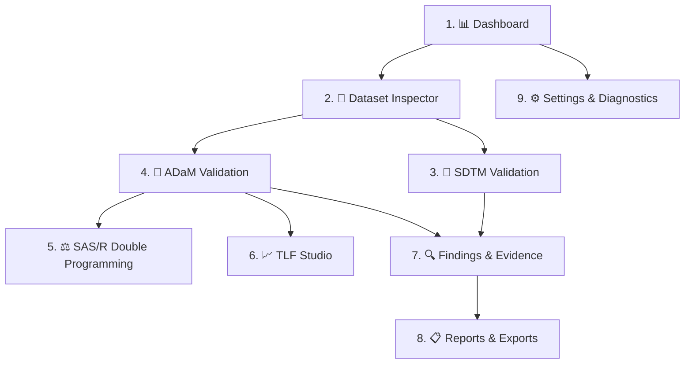

# ClinicalOps AI Agent — Clinical Statistical Programming & Validation Workbench

> **Professional Clinical Statistical Programming, CDISC Validation, and Double-Programming Workbench** for Biostatisticians, Statistical Programmers, and Clinical Data Managers. Built on CDISC SDTMIG v3.3/3.4, CDISC ADaMIG v1.3, Define-XML v2.1, ICH E3, ICH E6(R3), ICH M11, and 21 CFR Part 11 principles.

[](#automated-validation--testing)
[](#cdisc-standards--validation-coverage)
[](#traceability-lineage--audit-trail)
[](https://narasimhamachineni.github.io/clinical-ai-agent/)

---

## 1. Architecture & 9-Tab Workbench Layout

The user interface has been consolidated into 9 focused, professional clinical programming tabs:



### 9 Core Workbench Tabs
1. **📊 Dashboard**: Executive Study Telemetry, 11-Stage Pipeline Architecture, Live Study Metrics (Subjects, Safety Population, Hy's Law Alert, Serious AEs, Conformance Status), and Fast Action Hub.
2. **📁 Dataset Inspector**: Multi-domain browsing (`DM`, `AE`, `LB`, `VS`, `EX`, `DS`, `CM`, `MH`, `SUPPQUAL`, `ADSL`, `ADAE`, `ADLB`, `ADVS`, `ADTTE`), fast pagination, search & filtering, Dataset Profiler, Subject Digital Twin, and bidirectional lineage trace.
3. **📐 SDTM Validation**: Deterministic CDISC SDTMIG v3.3/3.4 conformance engine with domain filters, rule identifiers, expected vs actual values, and variable metadata.
4. **🔬 ADaM Validation**: Analysis dataset derivations (subject uniqueness in `ADSL`, population flags `SAFFL`/`ITTFL`, `BASE`, `CHG = AVAL - BASE`, `PCHG`, parameter invariance, TEAE chronology, `ADTTE` time-to-event duration, and Hy's Law hepatotoxicity screening).
5. **⚖️ SAS/R Double Programming**: Dual code generation (SAS DATA Step/PROC REPORT vs R `pharmaverse/admiral`), truthful runtime availability reporting, and an independent dataset reconciliation engine comparing record keys, schema, and numeric tolerances ($\pm 10^{-5}$).
6. **📈 TLF Studio**: Specification-driven ICH E3 tables (14-1 Demographics, 14-2 Adverse Events, 14-3 Lab Shifts, 14-4 Vital Signs, 14-5 Disposition, 14-6 Primary Efficacy), clinical listings (16.2.1, 16.2.4, 16.2.7), Kaplan-Meier figures, and verifiable denominator drill-down (`openTlfCellDrillDown`).
7. **🔍 Findings & Evidence**: Centralized Quality & Findings Center with 7-state cell accountability matrix, controlled non-destructive correction workflow (`Detect → Explain → Propose → Review → Approve → Apply → Revalidate`), and SHA-256 evidence logs.
8. **📋 Reports & Exports**: 16-Section Regulatory Review Report, CDISC Define-XML 2.1 generator, eCTD Module 5 package organizer, and controlled clean dataset workbook downloads.
9. **⚙️ Settings & Diagnostics**: Live measured performance telemetry (Profile, Validation, Grid render, Filter, Search, Memory footprint), CDISC Standards Registry, 12-subsystem health monitor, and 29-feature registry.

---

## 2. Absolute Data Principles & Runtime Truthfulness

- **No Synthetic Patient Fabrication**: Real parsed datasets only. Ingestion of `.sas7bdat` proprietary binary files inspects file metadata and variable descriptors honestly without generating simulated rows.
- **Source Immutability**: All uploads are stored in immutable raw snapshots (`StudyDataStore.rawSnapshots`). Active working datasets reflect transformations, but raw inputs remain untouched and support 1-click rollback (`rollbackToRaw`).
- **Truthful Runtime Telemetry**: The web client runs statically on GitHub Pages. External SAS 9.4 and R runtimes are reported as `DISCONNECTED (STATIC HOST)`, while in-browser code generation, metadata inspection, and output reconciliation run deterministically.
- **Dynamic Regulatory State**: No static "GxP Production Ready" claims. All indicators dynamically report verified statuses: `STANDBY`, `NOT ASSESSED`, `NOT EXECUTED`, `PASS`, `FAIL`, or `REVIEW_REQUIRED`.

---

## 3. CDISC Standards & Validation Coverage

| Domain | Standard | Key Validation Checks |
| :--- | :--- | :--- |
| **DM** | SDTMIG v3.3 | Required keys (`STUDYID`, `USUBJID`), `SEX` in (M, F, U, UNDIFFERENTIATED), `AGE` $\ge 0$, ISO 8601 dates (`RFSTDTC`, `RFENDTC`) |
| **AE** | SDTMIG v3.3 | Required `AETERM`, `AEDECOD`, date chronology (`AESTDTC` $\le$ `AEENDTC`), sequence uniqueness (`AESEQ`), `AESER`='Y' criteria |
| **LB** | SDTMIG v3.3 | `LBTESTCD`, numeric conversions (`LBSTRESN`), reference limits (`LBSTRESL`, `LBSTRESH`), toxicity grades |
| **VS** | SDTMIG v3.3 | Vital signs measurements, position consistency, ISO 8601 timestamps |
| **EX** | SDTMIG v3.3 | Exposure dose, dose units, route of administration, treatment duration |
| **DS** | SDTMIG v3.3 | Milestone epochs, study completion flags, discontinuation categorizations |
| **CM** | SDTMIG v3.3 | Concomitant medication coding, start and end dates relative to reference study dates |
| **MH** | SDTMIG v3.3 | Medical history coding and chronology relative to informed consent |
| **SUPP** | SDTMIG v3.3 | Supplemental qualifiers parent domain (`RDOMAIN`), key variable linkage (`IDVAR`), key value (`IDVARVAL`) |
| **ADSL** | ADaMIG v1.3 | One record per `USUBJID`, population flags (`SAFFL`, `ITTFL`, `PPFL`), treatment assignments (`TRT01P`, `TRT01A`), treatment duration (`TRTDURD = TRTEDT - TRTSDT + 1`) |
| **ADAE** | OCCDS v1.1 | Treatment-emergent flag derivation (`TRTEMFL` vs `TRTSDT`), MedDRA coding alignment, severity scoring |
| **ADLB** | BDS v1.3 | Baseline flag (`ABLFL`), baseline value (`BASE`), mathematical derivations (`CHG = AVAL - BASE`, `PCHG`), and Hy's Law screening ($ALT \ge 3\times\text{ULN} \land BILI \ge 2\times\text{ULN} \land ALP < 2\times\text{ULN}$) |
| **ADVS** | BDS v1.3 | Baseline selection and delta derivations for systolic BP, diastolic BP, heart rate, weight |
| **ADTTE**| BDS-TTE v1.3 | Parameter invariance, binary censoring flag (`CNSR` in 0, 1), time-to-event duration (`AVAL = ADT - STARTDT + 1`), chronology (`ADT \ge STARTDT`) |

---

## 4. Controlled Correction & Revalidation Lifecycle

Corrections follow strict GxP computer system validation controls:

$$\text{Detect} \longrightarrow \text{Explain} \longrightarrow \text{Propose} \longrightarrow \text{Review} \longrightarrow \text{Approve} \longrightarrow \text{Apply} \longrightarrow \text{Revalidate}$$

1. **Detect**: Deterministic rules evaluate datasets cell-by-cell.
2. **Explain**: Race-guarded explanation engine tracks 8 identity coordinates (`domain`, `recordKey`, `variable`, `ruleId`, `severity`, `expected`, `actual`, `timestamp`).
3. **Propose**: Deterministic standardizations propose automated fixes; clinical ambiguities are flagged `REVIEW_REQUIRED`.
4. **Review & Approve**: Explicit approval required before application.
5. **Apply**: Transformation modifies active dataset while preserving immutable raw snapshot.
6. **Revalidate**: Immediate automated re-run verifies defect elimination.
7. **Rollback**: Full 1-click restoration to raw EDC source.

---

## 5. Traceability, Lineage & Audit Trail

- **Bidirectional Lineage**: Maps CRF Field $\rightarrow$ SDTM Domain/Variable $\rightarrow$ ADaM Derivation $\rightarrow$ CSR Table Cell.
- **Cryptographic Evidence Locker**: All critical operations produce tamper-evident SHA-256 evidence records (`AUD-...`) complying with 21 CFR Part 11 requirements.
- **7-State Cell Accountability**: Every cell in every dataset is classified under mutual exclusivity:
  - `RAW_SOURCE_VALID`
  - `STANDARDS_CONFORMANT`
  - `DERIVED_DETERMINISTIC`
  - `DISCREPANT_OPEN`
  - `CORRECTED_APPROVED`
  - `REVIEW_REQUIRED`
  - `EXCLUDED_UNASSIGNED`

---

## 6. Automated Validation & Testing

Run the complete 180-test regression and master verification fleet:

```bash
# Run v15.0 Master Refactoring & Acceptance Suite (21 tests)
node scripts/test_v15_master_refactor.js

# Run Production Operations & Orchestration Suite (21 tests)
node scripts/test_v14_clinical_os_and_features.js

# Run Standards Registry & Status Integrity Suite (40 tests)
node scripts/test_v14_standards_and_integrity.js

# Run Master Acceptance Suite (73 tests)
node scripts/test_v13_ultimate_clinical_os.js

# Run End-to-End Clinical Intelligence Suite (25 tests)
node scripts/test_tab_sync_and_copilot.js
```

### Result: 180 / 180 Tests Passing (100% Green)

---

## 7. Getting Started

### Prerequisites
- **Node.js**: v18.0 or later (v24 tested)
- **Modern Web Browser**: Chrome, Edge, Safari, Firefox

### Local Development Launch
```bash
git clone https://github.com/NarasimhaMachineni/clinical-ai-agent.git
cd clinical-ai-agent
npm install
node server.js
```
Open `http://localhost:3000` in your browser.

### GitHub Pages Static Deployment
The repository is fully configured for static hosting via GitHub Pages from root (`index.html`, `app.js`, `style.css`, `engines/`). The `public/` folder is maintained in 100% synchronization for the local Express server.
