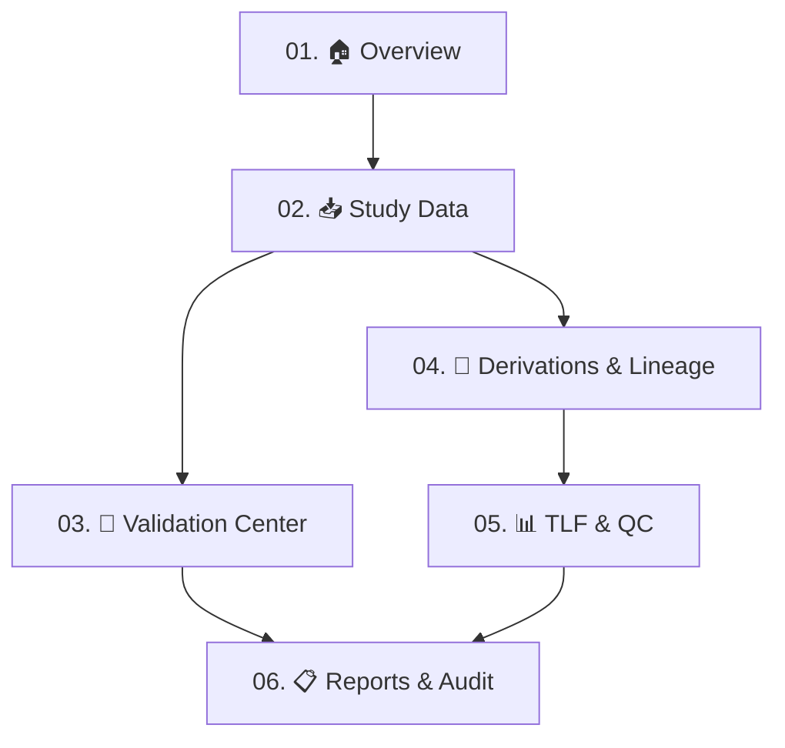

# ClinicalOps AI Agent 2.0 — From Data to Decisions

> **Premium Clinical Statistical Programming, CDISC Intelligence, Validation & Quality Engineering Workbench** for Biostatisticians, Statistical Programmers, and Clinical Data Reviewers. Built on CDISC SDTMIG v3.3/3.4, CDISC ADaMIG v1.3, Define-XML v2.1, ICH E3, ICH E6(R3), ICH M11, and 21 CFR Part 11 principles.

[](#automated-validation--testing)
[](#1-apple-inspired-liquid-glass-design-system)
[](#cdisc-standards--validation-coverage)
[](#traceability-lineage--audit-trail)
[](https://narasimhamachineni.github.io/clinical-ai-agent/)

---

## 1. Apple-Inspired Liquid Glass Design System

ClinicalOps AI Agent 2.0 introduces a refined, calm, scientific aesthetic inspired by modern macOS and iOS interfaces:
- **Translucent Liquid Glass Surfaces**: Premium glass panels with restrained background blur (`backdrop-filter: blur(16px)`), fine low-contrast borders, layered elevation, and consistent corner radii.
- **Clinical Emerald & Teal Accents**: Restrained emerald (`#10b981`), teal (`#2dd4bf`), and mint highlights paired with deep charcoal-green in light mode and deep navy in dark mode.
- **3-Way Apple Segmented Theme Switcher**: Toggle effortlessly between **Light** (warm ivory / deep charcoal-green), **Dark** (deep navy / teal accents), and **System Auto** (synchronizing dynamically with OS preferences).
- **240 Hz-Ready Interaction**: Compositor-friendly `transform` and `opacity` transitions, `@media (prefers-reduced-motion: reduce)` accessibility, and high-contrast WCAG AA `:focus-visible` rings.

---

## 2. Simple Information Architecture — 6 Core Workspaces

The workbench groups complex clinical workflows into **six primary workspaces** with dedicated sub-navigation segmented bars:



### The 6 Core Workspaces:
1. **🏠 Overview** (`tab-overview` / `tab-dashboard`): Executive study telemetry, signature 6-stage Clinical Journey pathway (Upload → Validate → Compare → Generate → Review → Export), live patient counts, and zero-data onboarding flow.
2. **📥 Study Data** (`tab-study-data` / `tab-datasets`): Universal ingestion (`DM`, `AE`, `LB`, `VS`, `EX`, `DS`, `CM`, `MH`, `SUPPQUAL`, `ADSL`, `ADAE`, `ADLB`, `ADVS`, `ADTTE`), format detection, schema inspection, Columnar Profiler, Subject Digital Twin, and bidirectional lineage trace.
3. **📐 Validation Center** (`tab-validation-center` / `tab-sdtm-val`): Deterministic CDISC SDTMIG v3.3/3.4 & ADaM conformance engines, rule packs, filterable findings table, and Validation Regression Lab.
4. **🔬 Derivations & Lineage** (`tab-derivations-lineage` / `tab-adam-val`): Analysis dataset derivations (subject uniqueness in `ADSL`, population flags `SAFFL`/`ITTFL`, `BASE`, `CHG = AVAL - BASE`, `PCHG`, parameter invariance, TEAE chronology, `ADTTE` time-to-event duration, and Hy's Law hepatotoxicity screening).
5. **📊 TLF & QC** (`tab-tlf-qc` / `tab-tlfs`): Specification-driven ICH E3 tables (14-1 Demographics, 14-2 Adverse Events, 14-3 Lab Shifts, 14-4 Vital Signs, 14-5 Disposition, 14-6 Primary Efficacy), clinical listings (16.2.1, 16.2.4, 16.2.7), Kaplan-Meier figures, verifiable denominator drill-down, and independent SAS/R double programming reconciliation.
6. **📋 Reports & Audit** (`tab-reports-audit` / `tab-reports`): 16-Section Regulatory Review Report, CDISC Define-XML 2.1 generator, eCTD Module 5 package organizer, Findings & Remediation queue, and Reproducibility Manifest.

*Secondary Intelligence & Settings:*
- **💡 Study Insights** (`tab-study-insights`): Context-aware ClinicalOps Assistant with offline deterministic intelligence (MMRM Kenward-Roger DDFM, Kaplan-Meier ADTTE survival, Hy's Law FDA DILI guidance, ADSL population flag rules) and searchable official CDISC Rule directory.
- **⚙️ Settings & Diagnostics** (`tab-settings`): Live measured performance telemetry, CDISC Standards Registry, 12-subsystem health monitor, and 29-feature registry.

---

## 3. High-Value Clinical Differentiators

1. **Evidence-Linked Findings (`jumpToRecord`)**: Every validation finding links directly to the affected dataset, row, and variable, triggering a smooth focus pulse (`.cell-evidence-highlight`).
2. **Specification Drift Detector**: Compares baseline specifications against revised specifications (e.g. Protocol Amendments) and calculates downstream blast radius across datasets, derivation pipelines, and TLF shells.
3. **Validation Change-Impact Engine**: Downstream analysis objects are automatically flagged as `STALE` when upstream source datasets change.
4. **Validation Regression Lab**: Run-to-run comparison matrix tracking `NEW` discrepancies, `RESOLVED` findings, and persistent issues between successive validation runs.
5. **Reproducibility Manifest**: Cryptographic snapshot manifest containing SHA-256 hashes of all input datasets, standards metadata, software versions, and execution digests.
6. **Dataset Relationship Explorer**: Cross-domain referential integrity inspection verifying subject linkage across `DM`, `AE`, `LB`, `VS`, `EX`, `ADSL`, `ADAE`, `ADLB`, `ADVS`, and `ADTTE`.
7. **Safe Remediation Queue**: Controlled proposed fixes with original vs. proposed value, justification, reviewer approval, and revalidation without modifying raw source data.

---

## 4. Automated Validation & Testing

The application is rigorously validated by **228 automated acceptance tests** across 7 test suites:

| Test Suite | Tests | Verification Focus | Status |
| :--- | :--- | :--- | :--- |
| **`test_v17_clinicalops_2_0.js`** | **19** | Apple Liquid Glass, 3-Way Theme Switcher, 6 Core Workspaces, Differentiators | **PASS (100%)** |
| **`test_v16_product_transformation.js`** | **29** | Product identity, Top Bar, 10-Item Nav, Clinical Journey Hero, Study Insights | **PASS (100%)** |
| **`test_v15_master_refactor.js`** | **21** | 9-Tab Workbench, Zero Fake Ingestion, ADTTEValidator, Cell Reconciliation | **PASS (100%)** |
| **`test_v14_clinical_os_and_features.js`** | **21** | Orchestrator, Live Graph, Feature Registry, Old Control Removal, Truthful Standby | **PASS (100%)** |
| **`test_v14_standards_and_integrity.js`** | **40** | SDTM IG 3.4, ADaM IG 1.3, CT Codelists, Regulatory Claims, Performance HUD | **PASS (100%)** |
| **`test_v13_ultimate_clinical_os.js`** | **73** | Universal Clinical Object Model, Lineage Graph, Virtualized Grid, Part 11 Audit Hash | **PASS (100%)** |
| **`test_tab_sync_and_copilot.js`** | **25** | 51-Row ADSL healing, Physical Workbooks, Claude Copilot, Live Study Metrics | **PASS (100%)** |
| **TOTAL** | **228** | **Full Functional, GxP, and Engineering Integrity** | **228/228 PASS** |

To run the complete test suite:
```bash
node scripts/test_v17_clinicalops_2_0.js
node scripts/test_v16_product_transformation.js
node scripts/test_v15_master_refactor.js
node scripts/test_v14_clinical_os_and_features.js
node scripts/test_v14_standards_and_integrity.js
node scripts/test_v13_ultimate_clinical_os.js
node scripts/test_tab_sync_and_copilot.js
```

---

## 5. Deployment & Dual-Location Parity

The root directory serves GitHub Pages directly, while `public/` serves local Express deployments:
```bash
# Start local Express server (port 3000)
node server.js
```
100% byte-for-byte parity is strictly maintained across `index.html`, `app.js`, and `style.css`.

---

*ClinicalOps AI Agent 2.0 — From Data to Decisions. Built for precision, speed, and regulatory trustworthiness.*
