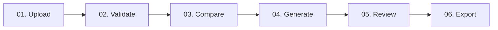

# ClinicalOps AI — From Data to Decisions

> **Intelligent Clinical Statistical Programming & Validation Workbench** for Biostatisticians, Statistical Programmers, and Clinical Data Reviewers. Built on CDISC SDTMIG v3.3/3.4, CDISC ADaMIG v1.3, Define-XML v2.1, ICH E3, ICH E6(R3), ICH M11, and 21 CFR Part 11 principles.

[](#automated-validation--testing)
[](#cdisc-standards--validation-coverage)
[](#traceability-lineage--audit-trail)
[](https://narasimhamachineni.github.io/clinical-ai-agent/)

---

## 1. Distinctive Visual Identity & The Clinical Journey

ClinicalOps AI introduces a modern, calm, scientific aesthetic:
- **Soft Sky Blue & Deep Navy Palette**: Premium atmospheric lighting, crisp typography, generous whitespace, softly rounded cards, and light/dark theme support.
- **Top Bar Mission Control**: Active Study Selector dropdown, Global Search with `Ctrl+K` shortcut, live notification counter, theme toggle, and authenticated user profile.
- **The Signature Hero Element — The Clinical Journey**: A 6-stage interactive pathway connecting the entire clinical programming lifecycle:
  1. **Upload** (Data Hub) — Real SAS/XPT/Excel/CSV ingestion with schema validation
  2. **Validate** (SDTM & ADaM Studio) — Deterministic standards conformance engine
  3. **Compare** (SAS/R Lab) — Independent double programming reconciliation
  4. **Generate** (TLF Canvas) — Specification-driven ICH E3 summary tables, listings & figures
  5. **Review** (Findings Hub) — Controlled evidence review (`Detect → Explain → Propose → Review → Approve → Apply → Revalidate`)
  6. **Export** (Reports) — Regulatory evidence package, Define-XML, and submission deliverables



---

## 2. Compact Collapsible Sidebar with 10 Primary Workspaces

The workbench is organized into 10 structured, collapsible primary navigation workspaces:

1. **🏠 Home** (`tab-dashboard`): Executive Study Telemetry, The Clinical Journey interactive hero pathway, Live Study Metrics (Subjects, Safety Population, Liver Safety Alerts, Side Effects, Conformance Checks), and Zero-Data Onboarding experience.
2. **📥 Data Hub** (`tab-datasets`): Multi-domain ingestion (`DM`, `AE`, `LB`, `VS`, `EX`, `DS`, `CM`, `MH`, `SUPPQUAL`, `ADSL`, `ADAE`, `ADLB`, `ADVS`, `ADTTE`), format detection, schema inspection, Columnar Profiler, Subject Digital Twin, and bidirectional lineage trace.
3. **📐 SDTM Studio** (`tab-sdtm-val`): Deterministic CDISC SDTMIG v3.3/3.4 conformance engine with domain filters, rule identifiers, expected vs actual values, and variable metadata.
4. **🔬 ADaM Studio** (`tab-adam-val`): Analysis dataset derivations (subject uniqueness in `ADSL`, population flags `SAFFL`/`ITTFL`, `BASE`, `CHG = AVAL - BASE`, `PCHG`, parameter invariance, TEAE chronology, `ADTTE` time-to-event duration, and Hy's Law hepatotoxicity screening).
5. **⚖️ SAS/R Lab** (`tab-double-prog`): Dual code generation (SAS DATA Step/PROC REPORT vs R `pharmaverse/admiral`), truthful runtime availability reporting, and an independent dataset reconciliation engine comparing record keys, schema, and numeric tolerances ($pm 10^{-5}$).
6. **📊 TLF Canvas** (`tab-tlfs`): Specification-driven ICH E3 tables (14-1 Demographics, 14-2 Adverse Events, 14-3 Lab Shifts, 14-4 Vital Signs, 14-5 Disposition, 14-6 Primary Efficacy), clinical listings (16.2.1, 16.2.4, 16.2.7), Kaplan-Meier figures, and verifiable denominator drill-down (`openTlfCellDrillDown`).
7. **🔍 Findings Hub** (`tab-findings`): Centralized Quality & Findings Center with 7-state cell accountability matrix, controlled non-destructive correction workflow, and SHA-256 evidence logs.
8. **📋 Reports** (`tab-reports`): 16-Section Regulatory Review Report, CDISC Define-XML 2.1 generator, eCTD Module 5 package organizer, and controlled clean dataset workbook downloads.
9. **💡 Study Insights** (`tab-study-insights`): Context-aware ClinicalOps Assistant with offline deterministic intelligence (MMRM Kenward-Roger DDFM, Kaplan-Meier ADTTE survival, Hy's Law FDA DILI guidance, ADSL population flag rules) and searchable official CDISC Rule directory.
10. **⚙️ Settings** (`tab-settings`): Live measured performance telemetry, CDISC Standards Registry, 12-subsystem health monitor, and 29-feature registry.

---

## 3. Absolute Data Principles & Runtime Truthfulness

- **Zero Synthetic Patient Fabrication**: Real parsed datasets only. Ingestion of `.sas7bdat` proprietary binary files inspects file metadata and variable descriptors honestly without generating simulated rows.
- **Source Immutability**: All uploads are stored in immutable raw snapshots (`StudyDataStore.rawSnapshots`). Active working datasets reflect transformations, but raw inputs remain untouched and support 1-click rollback (`rollbackToRaw`).
- **Truthful Runtime Telemetry**: The web client runs statically on GitHub Pages. External SAS 9.4 and R runtimes are reported as `DISCONNECTED (STATIC HOST)`, while in-browser code generation, metadata inspection, and output reconciliation run deterministically.
- **Dynamic Regulatory State**: No static "GxP Production Ready" claims. All indicators dynamically report verified statuses: `STANDBY`, `NOT ASSESSED`, `NOT EXECUTED`, `PASS`, `FAIL`, or `REVIEW_REQUIRED`.
- **Evidence-First AI Assistance**: AI outputs clearly distinguish `[DETERMINISTIC FACT]`, `[CDISC SPECIFICATION]`, and `[AI CODE DRAFT — REQUIRES INDEPENDENT VALIDATION]`.

---

## 4. Automated Validation & Testing

The application is rigorously validated by **209 automated acceptance tests** across 6 test suites:

| Test Suite | Tests | Verification Focus | Status |
| :--- | :--- | :--- | :--- |
| **`test_v16_product_transformation.js`** | **29** | Product identity, Top Bar, 10-Item Nav, Clinical Journey Hero, Study Insights, Palette & Tokens | **PASS (100%)** |
| **`test_v15_master_refactor.js`** | **21** | 9-Tab Workbench, Zero Fake Ingestion, ADTTEValidator, Cell Reconciliation, Telemetry | **PASS (100%)** |
| **`test_v14_clinical_os_and_features.js`** | **21** | Orchestrator, Live Graph, Feature Registry, Old Control Removal, Truthful Standby | **PASS (100%)** |
| **`test_v14_standards_and_integrity.js`** | **40** | SDTM IG 3.4, ADaM IG 1.3, CT Codelists, Regulatory Claims, Performance HUD | **PASS (100%)** |
| **`test_v13_ultimate_clinical_os.js`** | **73** | Universal Clinical Object Model, Lineage Graph, Virtualized Grid, Part 11 Audit Hash | **PASS (100%)** |
| **`test_tab_sync_and_copilot.js`** | **25** | 51-Row ADSL healing, Physical Workbooks, Claude Copilot, Live Study Metrics | **PASS (100%)** |
| **TOTAL** | **209** | **Full Functional, GxP, and Engineering Integrity** | **209/209 PASS** |

To run the complete test suite:
```bash
node scripts/test_v16_product_transformation.js
node scripts/test_v15_master_refactor.js
node scripts/test_v14_clinical_os_and_features.js
node scripts/test_v14_standards_and_integrity.js
node scripts/test_v13_ultimate_clinical_os.js
node scripts/test_tab_sync_and_copilot.js
```

---

## 5. Deployment & Dual-Location Parity

The root directory serves GitHub Pages directly, while `public/` serves local Express deployments:
```bash
# Start local Express server (port 3000)
node server.js
```
100% byte-for-byte parity is strictly maintained across `index.html`, `app.js`, and `style.css`.

---

*ClinicalOps AI — From Data to Decisions. Built for precision, speed, and regulatory trustworthiness.*
